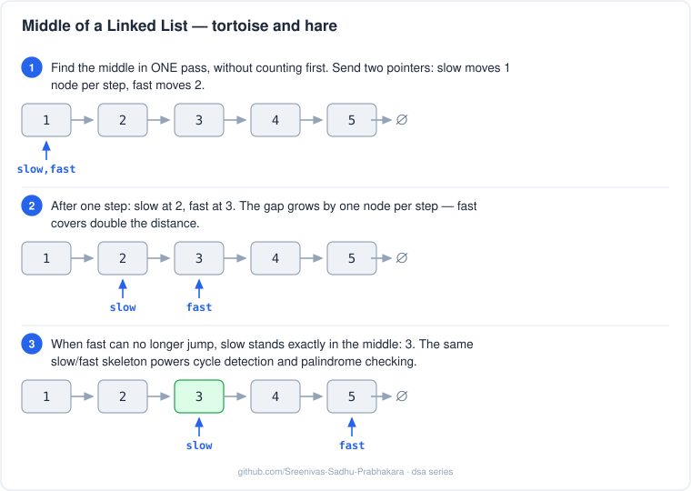

# Middle of a Linked List

> Striver SDE Sheet 026 · Day 5 Linked List — tortoise and hare: when the fast pointer finishes, the slow one stands in the middle. Go, stdlib only, tested.

## Problem

Return the middle node of a singly linked list in one pass — without first counting its length. For even lengths, return the second of the two middles.

## Approach

Two pointers from the head: `slow` steps once, `fast` steps twice. When `fast` can no longer move (nil, or its `Next` is nil), `slow` has covered exactly half the distance — the middle. The loop condition `fast != nil && fast.Next != nil` is what selects the *second* middle on even lengths and safely handles 1- and 2-node lists. The same slow/fast skeleton reappears in cycle detection and palindrome checking, which is why this trivial-looking problem is on the sheet.

**Complexity:** O(n) time, O(1) space, single pass.

## Visual walkthrough

Read the picture top to bottom — each numbered frame is one moment of the algorithm
running on this repo's test example.

## Run

    go test ./...   # verify
    go run .        # demo

---

One of 191 repos solving Striver's SDE Sheet in Go — stdlib only, one problem per repo, every solution tested. Browse the set: [`dsa-*` repos](https://github.com/Sreenivas-Sadhu-Prabhakara?tab=repositories&q=dsa-&type=source).
